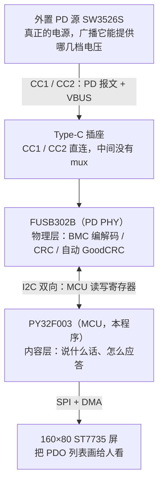
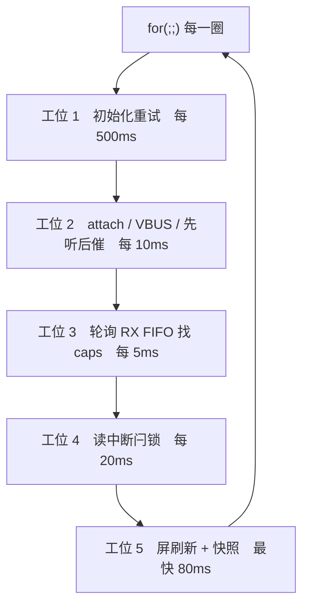
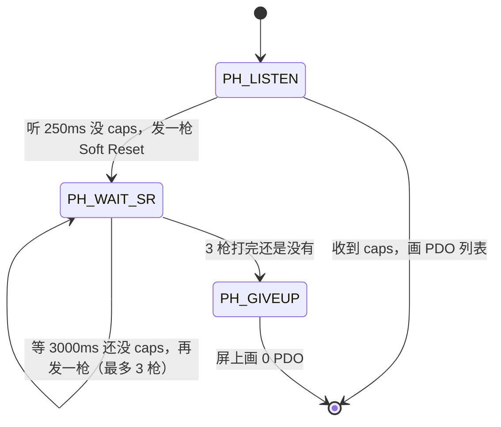
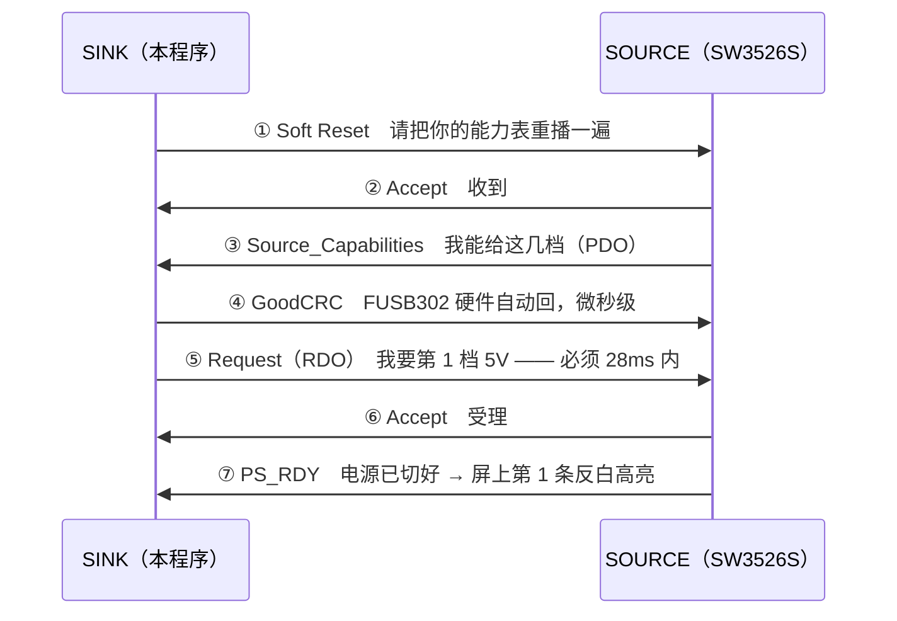

# FUSB302 业务逻辑详解

> 面向小白，从"谁负责什么"讲到寄存器级实现。  
> 对应工程：`EcoCheatOneT1` / `PD_PDO_List_Det`（PY32F003F18U6 + FUSB302B + 160×80 ST7735）  
> 最后更新：2026-10-09（Hard Reset 已提前到开机）

---

## 阅读建议

这份文档可以分三次读：

| 轮次  | 读哪几章            | 目标                          |
| --- | --------------- | --------------------------- |
| 第一轮 | 第 0 ~ 3 章       | 建立整体印象：谁跟谁说话、程序分几段          |
| 第二轮 | 第 4 ~ 5 章       | 搞懂"一次完整协商"到底发生了什么           |
| 第三轮 | 第 6 ~ 8 章       | 寄存器怎么配、中断怎么处理、Hard Reset 的坑 |
| 工具书 | 第 9 ~ 11 章 + 附录 | 看代码 / 排障时随时查                |

---

## 目录

- [第 0 章　先建立整体印象](#第-0-章先建立整体印象)
- [第 1 章　板子上的角色分工](#第-1-章板子上的角色分工)
- [第 2 章　PD 协议最小必要知识](#第-2-章pd-协议最小必要知识)
- [第 3 章　程序的三段时间线](#第-3-章程序的三段时间线)
- [第 4 章　主循环的五个工位](#第-4-章主循环的五个工位)
- [第 5 章　一次完整 PD 协商的全过程](#第-5-章一次完整-pd-协商的全过程)
- [第 6 章　FUSB302 寄存器配置逐条解释](#第-6-章fusb302-寄存器配置逐条解释)
- [第 7 章　中断处理](#第-7-章中断处理)
- [第 8 章　Hard Reset 的坑与"复活"](#第-8-章hard-reset-的坑与复活)
- [第 9 章　关键常量速查](#第-9-章关键常量速查)
- [第 10 章　没有串口，怎么看内部状态](#第-10-章没有串口怎么看内部状态)
- [第 11 章　故障排查对照表](#第-11-章故障排查对照表)
- [附录 A　文件与函数索引](#附录-a文件与函数索引)
- [附录 B　术语中英对照](#附录-b术语中英对照)

---

## 第 0 章　先建立整体印象

### 一句话

> 开机先打一枪 Hard Reset 把上一轮的合约清掉 → 等按键 → 按下后先安静听 250ms，  
> 没广播就发 Soft Reset 催（最多 3 枪）→ 收到 `Source_Capabilities` 就**当场**回一条  
> 只要第 1 档 5V 的 `Request` → 源端回 `PS_RDY` 说明谈成，屏上第 1 条 PDO 反白高亮。

### 三件最容易搞错的事

1. **PD 不是"一根线"，是"一根线上的对话"**。VBUS 负责送电，CC1/CC2 负责聊天。  
   屏幕上显示的电压电流，全部来自 CC 线上的文字，跟 VBUS 的实际电压没有直接关系。
2. **FUSB302 不做决定**。它只负责物理层：BMC 编解码、CRC、自动回 GoodCRC。  
   "该说什么话"是 PY32 的活。
3. **这个程序基本不用中断引脚**。INT 脚（PA0）接了、EXTI 也开了，但 ISR 里只清标志位，  
   一行 PD 代码都没有。所有 PD 处理都在主循环里靠**轮询寄存器**完成。

---

## 第 1 章　板子上的角色分工



### 硬件连接要点

| 连接         | 说明                                                 |
| ---------- | -------------------------------------------------- |
| CC1 / CC2  | FUSB302 **直连** Type-C 插座，中间没有任何 mux/开关。插哪一面就上哪根 CC |
| VBUS       | 送到 MCU 供电域（本工程整板由电脑 3V3 供电，VBUS 只作检测）              |
| I2C1       | MCU ↔ FUSB302，7 位地址 `0x22`                         |
| SPI1 + DMA | MCU → ST7735 屏，DIV2 = 12MHz                        |
| PA0        | FUSB302 的 `INT` 脚（接了 EXTI0 上升沿，但本程序不用它做处理）         |
| PA1        | 按键（外部 3V3 上拉，`WaitForButton()` 里另补内部上拉）            |

### 一个非常重要的硬件事实

**FUSB302 由板上 3V3 供电，MCU 复位它并不掉电。**

所以当你复位/重新烧录 MCU 时：

- FUSB302 里的 `Switches0`（Rd 下拉）、`Switches1`（TXCC 通道）、  
  以及"上一轮谈好的合约状态"**全部原样保留**；
- 源端那边也不知道你复位过，它认为"Sink 还挂着、合约还有效"，不会重播能力表。

**这就是为什么开机必须打一枪 Hard Reset**（详见第 3 章 ①）。

---

## 第 2 章　PD 协议最小必要知识

### 2.1 术语表

| 词          | 全称                  | 大白话                                      |
| ---------- | ------------------- | ---------------------------------------- |
| Source     | 供电方                 | 外置的 SW3526S                              |
| Sink       | 用电方                 | 你这块板子                                    |
| PDO        | Power Data Object   | 源端喊"我能给你这几档"，每档一个 32 位数                  |
| RDO        | Request Data Object | 我方回答"我要第几档、要多少电流"                        |
| Contract   | 合约                  | 源端回 `PS_RDY` 之后，双方"签了合同"，VBUS 切到那一档并保持   |
| GoodCRC    | —                   | 每收到一条报文都要回的"我收到了"。**FUSB302 硬件自动回**      |
| Soft Reset | —                   | "把你的能力表再念一遍"。不断电，只重播                     |
| Hard Reset | —                   | "整个重来"。源端必须撤 VBUS 到 0V 再重建 5V，协议层和合约一起清零 |
| SOP        | Start of Packet     | 报文起始序列。本工程只用默认的 `SOP`（不含 SOP'/SOP''）     |

### 2.2 报文长什么样

PD 报文（不含 CRC）结构：

```
+--------+------------------+---------------------------+
| token  |  Header (2 字节)  |  数据对象 NDO × 4 字节     |
| 1 字节  |  小端：低字节先发  |  小端：低字节先发          |
+--------+------------------+---------------------------+
```

**Header 的 16 个 bit 位域**（这是全篇最重要的一张表）：

| bit   | 宽度 | 名字               | 含义                              |
| ----- | -- | ---------------- | ------------------------------- |
| 4:0   | 5  | `msgType`        | 报文类型（见下表）                       |
| 5     | 1  | `dataRole`       | 0 = UFP(Sink)，1 = DFP(Source)   |
| 7:6   | 2  | `specRev`        | 协议版本：0=Rev1.0，1=Rev2.0，2=Rev3.0 |
| 8     | 1  | `powerRole`      | 0 = Sink，1 = Source             |
| 11:9  | 3  | `msgId`          | 报文序号 0~7 循环，用来配对"请求-应答"         |
| 14:12 | 3  | `numDataObjects` | 后面跟几个 4 字节数据对象（NDO）             |
| 15    | 1  | `extended`       | 扩展报文标志                          |

**常用的 `msgType`**：

| 值  | 名字                    | 方向        | 含义                    |
| -- | --------------------- | --------- | --------------------- |
| 1  | `Source_Capabilities` | SRC → SNK | 源端能力表（NDO = PDO 条数）   |
| 2  | `Request`             | SNK → SRC | 我方申请（NDO = 1，内容是 RDO） |
| 3  | `Accept`              | 双向        | 受理                    |
| 4  | `Reject`              | 双向        | 拒绝                    |
| 6  | `PS_RDY`              | SRC → SNK | 电源已切好，合约生效            |
| 13 | `Soft_Reset`          | 双向        | 软复位                   |
| 15 | `GoodCRC`             | 双向        | 收到确认（硬件自动）            |

### 2.3 那条"28 毫秒"的红线

> **源端发完 `Source_Capabilities`、并收到我们的 GoodCRC 之后，  
> 会启动一个 24 ~ 30ms 的定时器（`tSenderResponse`）等我们的 `Request`。  
> 超时没等到 → 源端直接发 Hard Reset，并把 VBUS 拉低重启。**

抓包实测（同一次运行）：

```
SRC CAP  →  SNK GOOD CRC  →  +28.7ms  →  HRST
源端重播 caps → 又是 GOOD CRC → 又是 +28.7ms HRST …… 无限循环
```

表现就是 VBUS 在 5V / 0V 之间来回跳。

**所以**：程序里回 Request 的动作必须"收到 caps 的同一轮立刻做"，  
不能等到 UI 刷新那一路，更不能指望"等我把数据解析完再说"。

#### ⚠️ 最容易翻车的地方：广播停了之后

这条红线在**两种场景**下的松紧程度完全不一样，务必分清：

| | 源端**正在广播**（上电 5s 内） | 源端**广播停了之后** |
|---|---|---|
| caps 从哪来 | 它自己每 ~150ms 主动发一组 | **只有我们发 Soft Reset 催它**才发 |
| 我们发 Soft Reset 后多久收到 caps | 看运气（可能立刻，也可能等下一组） | **7.5ms**（它正等着呢，一催就回） |
| 我们有多少余量 | ~150ms | **只有 30ms** |

**广播停之后，"发 Soft Reset → 收 caps → 回 Request"整条链只剩 30ms。**  
这时候只要主循环被任何东西堵住超过 30ms，就必输。

本工程真实踩过这个坑：发 Soft Reset 时界面要从 `LISTENING...` 变成
`SOFT RESET 1/3`，触发了一次 **35ms 的整屏重画** —— 于是 caps 在 FIFO 里
躺了 28.5ms 才被读走，Request 落地时**迟到 0.738ms**，源端当场 `HRST`。
（详见 `README.md` §6g）

**教训**：界面刷新绝不能出现在"发 Soft Reset → 收 caps → 回 Request"
这条链上，哪怕一次 35ms 的整屏重画都能要命。现在的做法是**行级缓存**
（见第 4 章"工位 5"），一次状态更新最多只花 1 行 ≈ 4ms。

> **✅ 实测确认（2026-10-09 16:36 / 16:40）**：两种场景都过了 ——
> - **广播停之后**（`iicnow.csv`）：`SOURCE CAP → SNK REQUEST` 只用 **2.659ms**
>   （余量 ~27ms），发完 Soft Reset 后的总线静默从 **36.3ms 降到 5.9ms**；
> - **广播期内**（`iicnow2.csv`）：**2.701ms**，而且**根本不用发 Soft Reset**
>   （"先听 250ms"直接听到 caps）。
>
> 两份都和"广播期内"基准（2.662ms）一致。（详见 `README.md` §6g / §6g-补）

---

## 第 3 章　程序的三段时间线


> 按键那一刻 = 日志时基零点 = 你开始抓包的时刻。

### ① 开机第一枪

**目的**：清掉上一轮程序留下的合约（见第 1 章最后那段）。

**执行顺序（不能换）**：

| 步 | 动作                  | 为什么                                                |
| - | ------------------- | -------------------------------------------------- |
| 1 | `pd.init(I2C1)`     | 软复位芯片 + 配好 `AUTO_CRC` / `specRev` / 中断屏蔽           |
| 2 | `startSinkToggle()` | 让芯片自己"试"源端插在哪根 CC 上                                |
| 3 | `pollAttach()`      | 每轮读 `Status1a.TOGSS`，落定后就知道是 CC1 还是 CC2（最多等 800ms） |
| 4 | `selectCC(cc)`      | 把 Rd 下拉、`MEAS_CCx`（= RX 选线）、`TXCCx` 全钉到那根 CC       |
| 5 | `sendHardReset()`   | 写 `Control3.SEND_HARD_RESET = 1`，芯片自己组包发出          |

**为什么第 4 步必须在第 5 步之前**：PD 报文必须从**对的那根 CC** 发出去。  
早于 `selectCC()` 发送有可能发到空线上，等于对着空气喊话。

**时序后果**：源端收到 Hard Reset 后必须先把 VBUS 撤到 `vSafe0V`、再重建 `vSafe5V`，  
实测低约 **0.9 秒**，然后才开始重播 `Source_Capabilities`。

这段时间程序用 `PD_HR_RECOVER_MS = 2500ms` 的窗口**屏蔽掉**，  
不让主循环误判成"线被拔了"。

**重播的 caps 怎么处理**：**忽略**。PDO 检测从按键那一刻才开始。

### ② 等按键

这一段程序**什么都不做**，只在 `WaitForButton()` 里盯着 PA1。

按下瞬间记下 `g_log_t0` 作为日志时间零点，方便和抓包时间轴对齐。

> **踩过的坑**：`Studio_GPIO_Init()` 把 PA1 配成"输入 + 无上下拉"，  
> 完全依赖板上外部上拉。实测这里会悬空抖动 —— "等引脚变低"的自旋  
> 时而立刻通过、时而永远卡住（上一轮就是卡死在这里）。  
> 所以 `WaitForButton()` 里显式补了 `LL_GPIO_PULL_UP`，  
> 并且**不假定极性**：先记下静止电平，再等它变化并保持 30ms。

### ③ 五工位主循环

按键后进入一个永不退出的 `for(;;)`。详见第 4 章。

---

## 第 4 章　主循环的五个工位

主循环像个流水线，每一圈按固定顺序走五个工位，每个工位有自己的"节拍"。



| 工位                          | 节拍      | 干什么                                         |
| --------------------------- | ------- | ------------------------------------------- |
| **1. 初始化重试**                | 500ms   | `init` 失败过就在这里重试。**注意：重试时不再软复位**            |
| **2. attach / VBUS / 先听后催** | 10ms    | 状态机核心：有没有插上、VBUS 是不是真掉了、要不要发 Soft Reset     |
| **3. 轮询 RX FIFO**           | 5ms     | 看有没有收到报文；收到 caps 就**当场回 Request**           |
| **4. 中断闩锁**                 | 20ms    | 读 `INTERRUPTA/INTERRUPTB`，处理 Hard Reset 等事件 |
| **5. 屏刷新 + 快照**             | 最快 80ms | 只在画面"脏了"或到点时才重画                             |

### 工位 1：为什么重试时**不能**软复位

`init(..., doReset=true)` 会写 `RESET.SW_RES`，那是**整芯片软复位**，  
会把 `Switches0` 的 Rd 下拉一起撤掉。对源端来说，Rd 消失 = "Sink 拔出了"  
→ 源端撤 VBUS、重置协商。

所以：**只有开机那一次 `init` 允许 `doReset=true`**，之后所有重试都传 `false`。

### 工位 2：状态机核心（"先听后催"）



三个状态：

| 状态               | 等待时长   | 含义                                       |
| ---------------- | ------ | ---------------------------------------- |
| `PH_LISTEN`      | 250ms  | 按键后**先安静听**，看源端有没有正在广播                   |
| `PH_WAIT_SR`     | 3000ms | 已发 Soft Reset，等源端重播                      |
| `PH_LISTEN_LONG` | 2500ms | 刚经历 Hard Reset / VBUS 恢复，源端要 ~1s 才重播，安静等 |
| `PH_GIVEUP`      | —      | 终态，画 `0 PDO`                             |

**为什么"先听"只要 250ms**：实测源端广播期间大约每 150ms 一组  
`Source_Capabilities`（4872.6 / 5022.0 / 5171.4 …，每组 3 条、组内间隔 2ms），  
所以 250ms 足够判断"有没有"。早期版本用 2000ms，导致业主抱怨  
"按下约 2 秒后才发 Soft Reset"。

**VBUS 判据为什么不能短**：源端响应 Soft Reset 时会主动把 VBUS 拉低约 0.9 秒  
（实测 3921→4786ms）。如果去抖窗口太短（旧版 3×20ms = 60ms），  
就会被误判成"拔出"，于是清状态、重开 toggle，源端随后那 5 秒广播全部丢掉。  
现在改成时间型：**VBUS 连续低 `PD_DETACH_MS = 1500ms` 才算真拔出**。

**"掉过又回来"当什么处理**：当成**源端重启过**（Soft Reset / Hard Reset 都会这样），  
直接做一次 `pd.recover()` 复活 —— 因为实测 FUSB302 收到 Hard Reset 后  
`Status1.RX_EMPTY` 恒为 1，不复位就永远收不到后面的 caps。

### 工位 3：收到 caps 之后必须"当场"回 Request

这是整个程序最紧张的一段。代码里 `sendRequest()` 就在"读到 caps"的**同一个 `if` 分支**里：

```
读到 Source_Capabilities
  ├─ 存下 lastMsg、havePdo = true
  ├─ pd.setSpecRev(msg.specRev)      ← 让硬件自动 GoodCRC 的报头合法
  ├─ Log(L_CAP) / Log(L_CAPHDR)
  └─ 立刻挑第一个 Fixed 档 → 拼 RDO → pd.sendRequest(rdo)   ← 28ms 红线
```

**挑档逻辑**：遍历 `msg.pdo[]`，找 `(pdo >> 30) == 0`（类型 0 = Fixed）的第一条，  
记下它的位置（从 1 起算）和原始值。如果一条 Fixed 都没有，就硬取第 1 条。

**RDO 怎么拼**（32 bit）：

```
rdo = (对象位置 << 28) | (工作电流 << 10) | 最大电流
        ↑ 4 bit            ↑ 10 bit          ↑ 10 bit
      第几档，从 1 起算     单位 10mA          单位 10mA
```

电流直接取源端该 PDO 里报的值（`pdoRaw & 0x3FF`），为 0 时兜底 300（= 3A）。


**为什么不用软件补发 GoodCRC**：PD 给 GoodCRC 的窗口只有几十微秒，  
等我们轮询到早就超时了，只会多出一条多余报文。  
正确做法是让硬件自动回：`Switches1.AUTO_CRC = 1` **且** `Control0.AUTO_PRE = 0`。

### 工位 4：中断闩锁 —— 详见第 7 章

### 工位 5：屏刷新

**内容真的变了才重画**（2026-10-09 第六轮改的，原来是每 80ms 无条件重画一次）。

判据是把"屏上画的是什么"打包成一个**指纹**（`struct UiFp`），和上一帧比：

| 指纹字段             | 来自哪                        | 影响屏上什么                    |
| ---------------- | -------------------------- | ------------------------- |
| `view`           | `havePdo` / `phase == PH_GIVEUP` | 选哪个视图（下面那三个出口）        |
| `cc`             | `g_diag.cc`                | 状态页 `WAIT ATTACH`          |
| `phase`          | `g_uiPhase`                | 状态页 `LISTENING...` / `LISTEN (HR)...` |
| `srTries`        | `g_uiSrTries`              | 状态页 `SOFT RESET n/3`        |
| `rdoAck`         | `g_rdoAck`                 | PDO 页第 1 条是否反白             |
| `pdoCount`       | `lastMsg.pdoCount`         | PDO 页画几行                    |
| `pdo[]`          | `lastMsg.pdo[i]`           | PDO 页每行的内容                  |

指纹一致**且**没人置 `dirty` → 这一轮**一条 SPI 都不发**。

三点要注意：

* **`dirty` 一个都没少。** 它现在是"强制重画"开关，各事件点（attach / 拔出 /
  收到 caps / 发出 RDO / `PS_RDY` / `REJECT` / Soft Reset / Hard Reset 恢复…）
  照旧置位 —— **事件驱动的刷新一条都没被砍掉**，砍掉的只是"没事也画"。
  指纹是**冗余的安全网**：以后新增一处会改屏上内容却忘了置 `dirty` 的地方，
  指纹会替它兜住。
* **`PD_UI_MIN_MS = 80ms` 还在，但语义变了**：它不再是"每 80ms 画一次"的周期，
  而是**两次重画之间的最小间隔**（限速）。指纹只回答"要不要画"，
  不回答"能不能立刻画"；协商期间 `dirty` 会被连发报文置得很密，有下限才不会
  把主循环刷成"只顾画图、顾不上收报文"。被下限挡下时**不更新指纹、也不清
  `dirty`**，所以下一轮过了下限一定会补画 —— 不丢帧，只晚几十毫秒。
* **`PD_UI_WATCHDOG_MS = 500ms` 是兜底（2026-10-09 第八轮改的）。** 纯"指纹 +
  dirty"有个死角：万一 SPI/DMA 偶发抽风把某行画坏了、而之后内容再没变过，
  那行就永远错着（旧版靠 80ms 重画自愈）。留一条慢速兜底把自愈能力保住。

  **但它每次只作废一行**（`g_rcWatchRow` 在 0..8 之间轮转），
  **不是整屏重画**。原因见下面"行级缓存"——整屏重画一次要 35ms，
  正好能吃掉源端等 Request 的那 24~30ms 窗口。

  代价：整屏自愈轮一遍从 2s 变成 9×500ms = 4.5s。看门狗本来只兜
  "偶发毛刺"，4.5s 完全够。

#### 行级缓存：为什么必须做（2026-10-09 第八轮新增）

**问题**：`Row()` 原来是无条件刷。`DrawStatus()` 一次要写 9 个 160×10 矩形
（标题条 + 6 行擦除 + 1 行文字），≈ 28.8KB SPI，实测 **35~47ms**。
而 `st7735_send_data()` 是**阻塞**的（每行都 `st7735_dma_wait()` 等
TC + BSY），所以这 35ms 里主循环**完全不干活** —— 连 FIFO 都不读。

**这在广播停之后是致命的**（原因见 2.3 那节）：caps 就在这 35ms 里躺进 FIFO，
等醒过来已经过了 28.5ms，Request 迟到 0.738ms → `HRST`。

**解法**：给每一行存一份"上次画的内容"，一样就跳过。

| 缓存                    | 存什么                          |
| --------------------- | ---------------------------- |
| `g_rcTxt[9][23]`      | 该行**补齐到 23 列之后**的文字（槽 8 给标题条，它没文字） |
| `g_rcFg[9]` / `g_rcBg[9]` | 画这一行时用的前景 / 背景色              |
| `g_rcOk[9]`           | "屏幕上确实是这个内容"的标志              |

`Row()` 先比"补齐后的文字 + 前景色 + 背景色"，三者全同就**直接 return**，
一个字节 SPI 都不发。

**为什么可以存全文而不是哈希**：RAM 上限 8KB，当前只用 ~4KB，
9×(23+2+2+1) = 252B 完全放得下；存全文就不存在哈希碰撞导致的"漏画"。

**为什么比的是"补齐后的文字"而不是"原文字"**：行尾补空格本来就是为了
**覆盖**上一帧，补齐后相同 ⇒ 像素完全相同 ⇒ 跳过是安全的。
前景/背景色也必须一起比 —— PDO 列表的反白高亮**只改配色、不改文字**。

**失效时机**：

1. **开机**：`g_rcOk` 全 0 → 第一帧 9 个矩形全画；
2. **看门狗**：每 500ms 只作废**一行**（轮转 0..8）—— 不能一次全作废，
   否则又变回 35ms 整屏重画，等于把刚修好的坑挖回来。

**效果**：发 Soft Reset 时真正变的只有第 3 行，所以一次状态更新
**35ms → ~4ms**，Request 能在 caps 到达后 ~10ms 内发出去，余量 ~20ms。

#### 开机必须"预铺整帧"（同一轮的补充）

行缓存有个**冷启动死角**：开机时 `ST7735_FillScreen()` 是**整屏直灌像素、
不走 `Row()`**，所以它一个缓存槽都不会填。如果开机只画了第 3/4/6 行，
那么第 0/1/2/5/7 行 + 标题条的 `g_rcOk` 全是 0 ——
**按键之后主循环第一帧会把 9 个矩形一次全画 = 35.3ms**。

这一帧正好落在"先听 250ms"窗口的**最开头**，于是又出现一个新的失败窗口：

| caps 落到线上的时刻 T（按键 = 0） | 我们读到它 | Request 发出 | 源端截止 T+30ms | 结果 |
|---|---|---|---|---|
| `[0, 1.5)` | 被 `recover()` 的 `rxFlush()` 冲掉 | — | — | 等下一组 ✅ |
| **`[1.5, 9)`** | **~37ms（被 35ms 挡住）** | **~38ms** | `T+30` | **迟到 → HRST ❌** |
| `[37, 250]` | `T+5` 以内 | `T+6` | `T+30` | 正常 ✅ |

源端每 ~145ms 广播一组，踩中那 6.5ms 窗口的概率约 **7%** ——
表现就是"**偶尔按一次就失败**"。

**解法**：开机就把整帧铺一遍（`HeaderBar()` + `Row(0,…)` + 把 1/2/5/7 行
显式画成空白），把 9 个缓存槽全部填满。这样按键后第一帧
**只剩第 3、4 行真的变** → **35.3ms 降到 ~8ms**，上表那行就永远不可能发生。

代价：开机多烧 ~24ms SPI —— 在等按键之前，没有任何 deadline。

**`g_snap[]` 快照每轮都写**（已从重画条件里移出来）。
它只有几十字节 RAM 写入 + 一个 `now` 时间戳，成本可忽略；但它本来就是给
OpenOCD 看的**实时体检表**（详见第 10 章），尤其 `[30]`/`[31]` 那两个
"中断进入次数 / 心跳顶事次数"计数器 —— 判"中断到底有没有在干活"全靠它们。
要是跟着重画一起变成"几十秒才更新一次"，这套诊断就废了。

三个出口，**不会出现第四种画面**：

| 条件                   | 画什么                                                     |
| -------------------- | ------------------------------------------------------- |
| `havePdo`            | PDO 列表（第 1 条在 `PS_RDY` 后反白高亮）                           |
| `phase == PH_GIVEUP` | `0 PDO`（红字）                                             |
| 其它                   | 状态视图（`WAIT ATTACH` / `LISTENING...` / `SOFT RESET n/3`） |

> **视图切换必须把上一帧完整盖掉。** `DrawPdoList()` 会把 8 行**全部**写满
> （PDO 行 + 末尾补空行），而 `DrawStatus()` 只用第 0 行和第 3 行。
> 所以 `DrawStatus()` 现在会先把第 1/2/4/5/6/7 行擦成黑色再画状态文字 ——
> 否则从 PDO 列表切回状态页（唯一路径是拔出）时，屏上会同时出现
> `WAIT ATTACH` 和上一帧的 `2 FIX 9.0V 3.00A 27W`。
> 开机那两行 `PRESS KEY` / `waiting button` 残留也是同一个原因。

---

## 第 5 章　一次完整 PD 协商的全过程

### 5.1 时序图



### 5.2 每一步在代码里对应什么

| 步   | 谁做的            | 代码位置                                                  |
| --- | -------------- | ----------------------------------------------------- |
| ①   | 主循环工位 2        | `pd.sendControl(PD_CTRL_SOFT_RESET)`                  |
| ② ③ | 源端主动发，我们只能被动收  | 工位 3 的 `pd.pollSourceCapabilities(msg)`               |
| ④   | **FUSB302 硬件** | 无需代码，靠 `Switches1.AUTO_CRC=1` + `Control0.AUTO_PRE=0` |
| ⑤   | 主循环工位 3        | `pd.sendRequest(rdo)`                                 |
| ⑥ ⑦ | 源端主动发          | 库把被跳过的 msgType 记在 `lastPeerMsgType()`，主循环据此判断         |

### 5.3 收报文：`pollSourceCapabilities()` 怎么拆包

FUSB302 的 RX FIFO 里，一条报文的字节序是：

```
token(1) + Header(2, 小端) + 数据对象(NDO × 4) + CRC(4)
```

库里的做法：

1. 先看 `Status1.RX_EMPTY`，空了就返回 false；
2. `fetchMessage()` 按上面格式逐字节 `popFifo()` 拆出来；
3. **如果是 GoodCRC 就跳过**（`continue`），因为那是我们自己发出去的确认；
4. 记下这条被跳过的 `msgType`（可能是 `ACCEPT`/`PS_RDY`/`REJECT`）；
5. 如果是 `Source_Capabilities`（`msgType == 1` 且 `NDO > 0`）→ 返回 true；
6. 其它报文忽略，继续看下一条。

**为什么要记 `lastPeerMsgType()`**：`ACCEPT` / `PS_RDY` / `REJECT` 都是控制报文，  
会被第 3 步跳过丢掉。但我们恰恰需要靠它判断"第 1 档到底申请成功没有"。  
所以库额外把"最后一条被跳过的 msgType"存下来给上层用。

主循环里的判断：

| 收到的            | 含义         | 动作                            |
| -------------- | ---------- | ----------------------------- |
| `ACCEPT`(0x03) | 只是受理，电源还没切 | 继续等                           |
| `PS_RDY`(0x06) | 电源已切到申请的档位 | `g_rdoAck = true` → 第 1 条反白高亮 |
| `REJECT`(0x04) | 被拒         | `g_rdoAck = false` → 保持普通配色   |

读到就 `clearLastPeerMsgType()` 消费掉，否则同一条应答会在后面每一轮里被反复处理。

### 5.4 PDO 怎么解码成"5.0V 3.00A 15W"

PDO 的 bit31:30 是类型：

| 值 | 类型       | 电压字段                                                        | 电流/功率字段           |
| - | -------- | ----------------------------------------------------------- | ----------------- |
| 0 | Fixed    | bit29:10 × 50mV                                             | bit9:0 × 10mA     |
| 1 | Battery  | max V = bit29:20 × 50mV，min V = bit19:10 × 50mV             | bit9:0 × 250mW    |
| 2 | Variable | max V = bit29:20 × 50mV，min V = bit19:10 × 50mV             | bit9:0 × 10mA     |
| 3 | APDO     | 看子类型，PPS 是 max V = bit24:17 × 100mV，min V = bit16:8 × 100mV | PPS：bit6:0 × 50mA |

> **PPS 是什么**：Programmable Power Supply，PD3.0 的可调压档位（比如 3.3~11V 连续可调）。  
> FUSB302B 虽然标称 PD2.0 PHY，但**可以支持 PD3.0 / PPS** ——  
> 关键点是 `Switches1.SPECREV` 只管"硬件自动 GoodCRC 的报头"，  
> 而我们自己组的报头用的是另一个变量 `m_hdrRev`，不受它限制。

屏上每行的格式：

```
1 FIX 5.0V 3.00A 15W          ← 拿到 caps 后的列表（第 1 条反白 = 申请成功）
2 FIX 9.0V 3.00A 27W
3 FIX 12.0V 3.00A 36W
4 PPS 3.3-11.0V 3.00A
0 PDO                          ← 催满 3 枪 Soft Reset 还是没等到 caps
```

---

## 第 6 章　FUSB302 寄存器配置逐条解释

`pd.init()` 的 10 个步骤，**顺序有意义，不能乱**：

| 步  | 寄存器                     | 写入值                      | 为什么                                            |
| -- | ----------------------- | ------------------------ | ---------------------------------------------- |
| 1  | `RESET` (0x0C)          | `SW_RES`                 | 整芯片软复位。**之后必须等 2ms**，否则后续写入会被丢弃                |
| 2  | `DEVICE_ID` (0x01)      | 读                        | 确认 I2C 通得上                                     |
| 3  | `POWER` (0x0B)          | `0x0F`                   | 打开全部电源域（测量块、接收器、振荡器）                           |
| 4  | `SWITCHES0` (0x02)      | `PDWN1｜PDWN2｜MEAS_CC1`   | 两根 CC 都挂 Rd 下拉（纯 Sink），先假定 CC1                 |
| 5  | `SWITCHES1` (0x03)      | `AUTO_CRC｜TXCC1｜SPECREV` | 开硬件自动 GoodCRC，先假定从 CC1 发                       |
| 6  | `CONTROL0` (0x06)       | `C0_BASE`                | **`AUTO_PRE = 0`**（见下面第 6.1 节的坑）               |
| 7  | `CONTROL3` (0x09)       | `0x00`                   | 关掉自动重发，诊断阶段要"发几次就是几次"                          |
| 8  | `MASK1/MASKA/MASKB`     | `0xEF / 0xEF / 0xFF`     | 放开 `I_CRC_CHK` 与 `I_RETRYFAIL`，让 INT 脚能触发      |
| 9  | `SLICE` (0x05)          | `0x60`                   | SDAC_HYS=01（迟滞 85mV），SDAC=0x20                 |
| 10 | `CONTROL1` / `CONTROL0` | 冲 FIFO                   | `RX_FLUSH` / `TX_FLUSH` 写完**立刻写回不含 flush 位的值** |

### 6.1 三个致命的寄存器坑

#### 坑一：`AUTO_PRE` 与自动 GoodCRC 的关系（最关键）

数据手册 "PD Automatic Receive GoodCRC" 写得很清楚：

> 自动回 GoodCRC 的条件是 **`AUTO_CRC = 1` 且 `AUTO_PRE = 0`**。

早期版本 `Control0` 写的是 `0x0E`（`AUTO_PRE = 1`），结果：

- 芯片收到好报文时改去"从 TX FIFO 自动起发"，**硬件自动 GoodCRC 反而被关掉了**；
- 于是只能软件补发 GoodCRC —— 但那个窗口只有几十微秒，**补不回来**；
- 源端每条 `Source_Capabilities` 重发 3 次，最后直接 Hard Reset。

**现在 `Control0 = 0x0C`（`AUTO_PRE = 0`）**，硬件自动 GoodCRC 才真正生效。

#### 坑二：发送必须写 `Control0.TX_START`

按官方数据手册，发送流程是：

1. 确认 `Status1.TX_EMPTY = 1`；
2. 写 `0x43`（FIFOS）写入 token + 数据；
3. **写 `Control0.TX_START = 1`**（bit0，自清除）← 这一步不能漏；
4. 等 `Interrupta` 的 `I_TXSENT`。

早期版本靠 FIFO 末字节的 `0xA1`（`TXON` 命令）触发，那是第三方工程的写法，  
**在这块芯片上不生效**。抓包证据：`Control0` 全程只出现过 `0x00 / 0x0C / 0x4C`，  
**从来没写过 `TX_START`**；逻辑分析仪在 CC 线上也只见源端的报文，  
看不到任何 sink 报文 —— 包压进 FIFO 了但根本没启动发送。

#### 坑三：`Switches1.SPECREV` 不能填 3.0

FUSB302B 是 PD2.0 PHY，手册对 bits[6:5] 的 `10` / `11` 明写 **"Do Not Use"**。  
填 `10`（Rev3.0）会让**硬件自动 GoodCRC 的报头非法**，源端直接丢掉。

> 注意区分两个"版本号"：
>
> - `Switches1.SPECREV`（硬件用）→ 只能 Rev1.0 / Rev2.0
> - `m_hdrRev`（我们自己组报头用）→ 可以到 Rev3.0
>
> 这就是为什么 PPS / PD3.0 能用，而自动 GoodCRC 也不会坏。

---

## 第 7 章　中断处理

### 7.1 结论先说：这个程序基本不用中断

硬件上 FUSB302 的 INT 引脚是**接了的**：PA0，配了 EXTI0 上升沿，NVIC 也开了。  
但是 —— **ISR 里只清了个标志位，一行 PD 代码都没有**：

```c
void EXTI0_1_IRQHandler(void)
{
  if (LL_EXTI_IsActiveFlag(LL_EXTI_LINE_0) != 0U) { LL_EXTI_ClearFlag(LL_EXTI_LINE_0); }
  if (LL_EXTI_IsActiveFlag(LL_EXTI_LINE_1) != 0U) { LL_EXTI_ClearFlag(LL_EXTI_LINE_1); }
}
```

所有真正的 PD 处理都在主循环的**工位 4** 里靠**轮询**完成。


### 7.2 为什么"轮询"反而更好用

关键在于 FUSB302 的中断寄存器是 **R/C（Read-to-Clear）** 类型：**读一次，它自己就清零了**。

这带来两个好处：

1. **天然就是"边沿检测"**。比如 `INTERRUPTA.bit0 = I_HARDRST`，读一次就清了，  
   绝不会"一直挂着导致每轮都重复触发"。
2. **不依赖 ISR 的实时性**。即使 20ms 才看一眼，只要这期间发生过事件，  
   闩锁位一定还在那儿等着。

### 7.3 中断寄存器位表

**`INTERRUPTA` (0x3E)** —— 全部 R/C：

| 位        | 名字               | 含义                       |
| -------- | ---------------- | ------------------------ |
| 0x80     | `I_OCP_TEMP`     | 过流 / 过温                  |
| 0x40     | `I_TOGDONE`      | toggle 探测完成              |
| 0x20     | `I_SOFTFAIL`     | 软件重试失败                   |
| 0x10     | `I_RETRYFAIL`    | 自动重发 3 次都没拿到对端 GoodCRC   |
| **0x08** | **`I_HARDSENT`** | **我方 Hard Reset 成功发上线了** |
| 0x04     | `I_TXSENT`       | 我方报文拿到了对端 GoodCRC        |
| 0x02     | `I_SOFTRST`      | 收到 Soft Reset            |
| **0x01** | **`I_HARDRST`**  | **收到 Hard Reset**（复活触发点） |

**`INTERRUPTB` (0x3F)**：

| 位    | 名字           | 含义                       |
| ---- | ------------ | ------------------------ |
| 0x01 | `I_GCRCSENT` | 芯片回过 GoodCRC（= 它收到过有效报文） |

程序每 20ms 把 `INTERRUPTA`、`INTERRUPTB`、`STATUS0A` 各读一次，  
非零就记一条 `L_INTA` / `L_INTB` 日志，同时累加到 `g_diag.intaAcc / intbAcc`。

### 7.4 一个容易踩的坑：为什么用 `INTERRUPTA.bit0` 而不是 `Status0a.HARDRST`

这两个都能表示"收到 Hard Reset"，但**性质完全不同**：

|          | `Status0a.HARDRST`                                  | `INTERRUPTA.bit0` |
| -------- | --------------------------------------------------- | ----------------- |
| 类型       | **状态位**                                             | **R/C 闩锁**        |
| 清零方式     | 只有 `PD_RESET` 能清                                    | 读一次自动清零           |
| 当触发条件会怎样 | 整个 Hard Reset 期间一直为 1，**每 20ms 触发一次复位**，把 FIFO 反复冲掉 | 天然只触发一次           |

所以程序里：

- **`INTERRUPTA.bit0` 当动作触发点**；
- `Status0a.HARDRST` 只当作诊断值记录（`g_snap[27]` / `g_snap[29]`）。

另外实测发现：**即使把 `MASKA.bit0` 置 1（屏蔽 INT 引脚），这个闩锁照样会置位**  
（抓包 4000.484ms 读到 `INTERRUPTA = 0x01`）。所以我们只轮询也能拿到，不必依赖 INT 脚。

---

## 第 8 章　Hard Reset 的坑与"复活"

这是整个项目里最难、也最值得记住的一段。

### 8.1 现象

源端发完 Hard Reset 之后，我们的 `Status1.RX_EMPTY` **恒为 1**，  
一条报文都进不了 RX FIFO。源端随后那 5 秒的 caps 广播，我们**全部丢掉**。

这就是当初"5 秒后再按按键，发了 Soft Reset 也读不到 PDO"的直接原因。

### 8.2 原因

**FUSB302 收到 Hard Reset 之后，内部的 PD 收发状态机就锁死了。**  
这是芯片行为，不是 bug。

### 8.3 解法

写一次 `Reset.PD_RESET`（bit1）。它只复位 PD 收发逻辑、**不动 I2C 寄存器内容**，  
所以之后必须把我们改过的收发相关寄存器再写一遍。

两家参考驱动都这么做：

| 参考实现                      | 函数                                 | 注释原文                                                               |
| ------------------------- | ---------------------------------- | ------------------------------------------------------------------ |
| Chromium `FUSB302-master` | `pd_reset()`                       | *"bring the FUSB302 out of reset after Hard Reset"*                |
| pdsink                    | `hr_cleanup()` → `fusb_pd_reset()` | *"Cleanup internal states after hard reset received **or sent**."* |

**注意 pdsink 那句里的 "or sent"** —— 我们**主动发出** Hard Reset 之后同样需要清理。

### 8.4 程序里三处会调 `pd.recover()`

| # | 时机            | 触发条件                          |
| - | ------------- | ----------------------------- |
| 1 | 收到 Hard Reset | `INTERRUPTA.bit0 = I_HARDRST` |
| 2 | VBUS "掉过又回来"  | 说明源端重启过                       |
| 3 | **按键之后**      | 因为开机那一枪是我们自己发的                |

第 3 处**不放在发完 HR 立刻**，是因为立刻写 `PD_RESET` 有可能打断  
刚发出去的那一条 Hard Reset 报文。

### 8.5 `pdReset()` 内部的顺序

```
1. 写 RESET.PD_RESET          复位 PD 收发逻辑
2. m_msgId = 0                 PD 规范：Hard Reset 后双方 MessageID 都要归零
3. rxFlush() + txFlush()       丢掉复位前残留的半包 / 垃圾
4. 重写 CONTROL0 / CONTROL1 / CONTROL3 / SLICE
5. selectCC(m_cc)              ★ 重钉 CC 路由
```

**第 5 步不能少**。因为 `MEAS_CCx` 同时就是 **RX 的选线开关**，  
不重钉的话 RX 依然收不到东西。

### 8.6 ⚠️ 实测：`recover()` **不保证一次就救回来**（2026-10-09 第八轮）

第八轮的抓包（`pdbad.csv` + `iicbad.csv`）里出现了一次"救不回来"：

| 时刻（绝对） | 事件 |
|---|---|
| 2952.812ms | 源端 `HRST`（它等 Request 超时了） |
| 2954.078ms | 我们读到 `INTERRUPTA=0x01`(I_HARDRST) + `STATUS0A=0x0D` |
| **2954.356ms** | **第 1 次 `recover()`**（`W44:0C 02` …）—— 反应很快，~1.3ms |
| 2954.4 → 3858.0ms | **900ms 里 FIFO 读（`0x43`）一次都没有** ← RX 还是死的 |
| **3858.043ms** | **第 2 次 `recover()`** |
| 3948.184ms | 源端 caps 终于进 FIFO，我们读到了 ✓ |

也就是说：**收到 HRST 后 `recover()` 确实会被立刻调用**（第 1 处触发点没问题），
但**第 1 次没能把 RX 救回来**，要等到第 2 次才活。

**后果**：一次协商超时 = 整场报废。源端在 15.6s 里重播了 **237 条
`SOURCE CAP`**，而我们只回了 **3 条 `GOOD CRC`**、**0 条 `REQUEST`**
（`SNK: GOOD CRC` 那 3 条还是 FUSB302 硬件自动回的）。

**当前判断**：第八轮的行级缓存改完之后，源端**不应该再发 HRST**
（Request 赶得上了），所以这条路径正常情况下走不到。
**如果烧录后仍偶发 `HRST`**，下一步就该在这里加固：
`recover()` 之后校验 `Status1.RX_EMPTY`，失败就再来一次（或重挂 CC）。

> **✅ 2026-10-09 16:36 复测：整场没触发。**
> `iicnow.csv` 里 `RESET(0x0C)` 只写了 **1** 次（init 那次），
> 236 次突发读里 `INTERRUPTA` **全是 `0x00`** —— 一次 Hard Reset 都没收到。
> 也就是说：**只要 Request 不迟到，源端就不会发 HRST，也就永远走不到这个坑里。**
> 这条先搁置，但代码里那个 `recover()` 路径保留不动（它是最后一道保险）。

---

## 第 9 章　关键常量速查

看代码时对着这张表，基本就懂了一半。

| 常量                      | 值      | 为什么是这个数                                 |
| ----------------------- | ------ | --------------------------------------- |
| `PD_RX_POLL_MS`         | 5ms    | 收 caps 的轮询节拍。必须够快，回 Request 的窗口只有 28ms  |
| `PD_ATTACH_POLL_MS`     | 10ms   | 查 VBUS / TOGSS 的节拍                      |
| `PD_INT_POLL_MS`        | 20ms   | 读中断闩锁的节拍                                |
| `PD_UI_MIN_MS`          | 80ms   | 两次重画之间的**最小间隔**（限速）。内容不变就不画，它只压"变太频繁" |
| `PD_UI_WATCHDOG_MS`     | 500ms  | 兜底自愈：内容一直不变也每 500ms **刷一行**（轮转 0..8）。**不是整屏** —— 整屏要 35ms，会吃掉等 Request 的窗口 |
| `PD_CFG_RETRY_MS`       | 500ms  | `init` 失败后的重试间隔                         |
| `PD_LISTEN_MS`          | 250ms  | 按键后"先听"的时长。源端每 ~150ms 广播一组，够判有无         |
| `PD_SR_WAIT_MS`         | 3000ms | 发完 Soft Reset 后等源端重播的时间                 |
| `PD_SR_MAX`             | 3      | 最多催 3 枪，之后进 `PH_GIVEUP` 画 `0 PDO`       |
| `PD_LISTEN_AFTER_HR_MS` | 2500ms | Hard Reset 后源端要先撤 VBUS ~0.9s、再过 ~1s 才重播 |
| `PD_HR_RECOVER_MS`      | 2500ms | 同上。这段 VBUS 低是**预期**的，不能判成拔出             |
| `PD_DETACH_MS`          | 1500ms | VBUS 连续低这么久才算真拔出。**不能短**                |
| `PD_DETACH_HOLD_MS`     | 300ms  | 判拔出后静置这么久才允许重新 attach                   |
| `PD_BOOT_ATTACH_MS`     | 800ms  | 开机探 attach 的上限，超时就先跳过                   |

---

## 第 10 章　没有串口，怎么看内部状态

这个工程**故意不用串口**，PDO 全画在屏上。但调试时总得看更多东西，  
所以有两套"暗门"。

### 10.1 `g_log[]` —— 64 条循环日志

每条 8 字节：

```
[0..3] 时间戳（ms，小端）
[4]    日志码
[5]    参数 a0
[6]    参数 a1
[7]    保留 0
```

用 OpenOCD / DAPLink 直接 dump 内存就能看到完整时间线。

**常用日志码**：

| 码      | 名字            | 含义                                               |
| ------ | ------------- | ------------------------------------------------ |
| 1      | `L_BOOT`      | 开机                                               |
| 2      | `L_LCD`       | 屏初始化完成                                           |
| 3      | `L_INIT`      | `pd.init` 成功 / 失败                                |
| 4      | `L_DEVID`     | 读到的 Device ID                                    |
| 5      | `L_ATTACH`    | 探测到 attach（arg0 = CC1/CC2；**0 表示开机没探到**）         |
| 6      | `L_SELCC`     | `selectCC` 结果                                    |
| 14     | `L_CAP`       | 收到 caps（arg0 = 条数，arg1 = specRev）                |
| 20     | `L_REATTACH`  | 模拟拔出 / 插入                                        |
| 23     | `L_HRST`      | 收到 Hard Reset                                    |
| 24     | `L_RECOVER`   | 做过一次 `PD_RESET` 复活                               |
| 25     | `L_RDO`       | 发出 Request                                       |
| 26     | `L_PSRDY`     | 收到 PS_RDY / REJECT                               |
| **27** | **`L_HRSND`** | **我方主动发 Hard Reset**（arg0 = 写寄存器成功，arg1 = 用的 CC） |
| 28     | `L_INTA`      | `INTERRUPTA` 值（含 `0x08` = `I_HARDSENT`）          |
| 29     | `L_INTB`      | `INTERRUPTB` 值                                   |


> **时间戳断点**：开机那几行日志（含 `L_HRSND`）的时间戳是**相对 MCU 上电的绝对毫秒**；  
> 按键之后才变成相对按键。日志里会有一个明显的"时间跳变"，那是正常的，不是 bug。

### 10.2 `g_snap[32]` —— 内存快照

主循环**每轮**把关键变量抄进去（2026-10-09 第六轮之前是"UI 每次刷新时"抄，
但那时 UI 每 80ms 无条件刷一次；现在改成"内容不变不重画"之后，如果还跟着
重画走，屏不动的时候快照就一直是旧的 —— 所以移出来改成每轮都写）。
屏幕上看不出来的东西，`mdw &g_snap 8` 一读就有。

> 为什么这两个计数器必须每轮更新：判"中断到底有没有在干活"**只看**它们。
> 正常情况 `[31]` 应恒为 0（中断先到，心跳根本轮不上）；若 `[31]` 跟着 `[30]`
> 一起涨 → 说明边沿没来、心跳在硬扛 → 回头查 PA0 上拉 / EXTI 触发沿 /
> `0x42` 有没有被读。

| 下标    | 内容                    | 下标     | 内容                                                      |
| ----- | --------------------- | ------ | ------------------------------------------------------- |
| 0     | `tried`               | 15     | `havePdo`                                               |
| 1     | `ready`               | 16-19  | 当前 tick（32 位）                                           |
| 2     | `idValid`             | **20** | **`g_rdoAck`（申请成功？）**                                   |
| 3     | `devId`               | 21     | `specRev`                                               |
| 4     | `toggleOn`            | 22     | 已发 Soft Reset 次数                                        |
| 5     | `busOk`               | 23     | TX 计数                                                   |
| 6     | `vbusOk`              | **24** | **`intaAcc`**（bit2=TXSENT bit4=RETRYFAIL bit3=HARDSENT） |
| 7     | `vbusRaw`（STATUS0 原值） | 25     | `intbAcc`（bit0=GCRCSENT）                                |
| 8     | `cc`                  | **26** | **`status1`**（bit5=RX 空 bit3=TX 空）                      |
| 9     | `ccSelected`          | **27** | **`status0a`**（bit0=HARDRST）                            |
| 10    | `rxMsgCount`          | 28     | `uiPhase`                                               |
| 11-12 | `lastHeader`          | 29     | `status0a & 0x01`                                       |
| 13    | `i2cErr` 低字节           | **30** | **中断进入次数低字节**（滚动）                                       |
| 14    | `attached`            | **31** | **心跳顶事次数低字节**（正常应恒为 0）                                  |

---

## 第 11 章　故障排查对照表

| 现象                     | 可能原因                                                   | 怎么查                                                         |
| ---------------------- | ------------------------------------------------------ | ----------------------------------------------------------- |
| 屏只有背光、没有画面             | 编译选项不对（曾用 `Optim 4` 编译出问题版本）                           | 必须 `Optim 2` + LTO 开；看开机三色自检                                |
| 三色闪烁出现，但文字是垃圾          | 字库指针问题（LTO 把字模表删了）                                     | 检查是否误用 `Font_7x10.data`，必须走 `font_get_font_glyph()`         |
| 屏正常但按键无反应              | `RowRender()` 里 `ci` 越界（`g_rowGlyph[22]` 被读到 `g_diag`） | 确认 `if (ci < COLS)` 这层夹子还在                                  |
| 按键后一直 `LISTENING...`   | 没收到 caps                                               | 看 `g_snap[7]`（STATUS0）确认 VBUS 在不在；看 `g_snap[26]` 的 RX_EMPTY |
| 发完 Soft Reset 仍读不到 PDO | FUSB302 PD 逻辑锁死，没做 `PD_RESET`                          | 看日志里有没有 `L_RECOVER(24)`                                     |
| VBUS 在 5V/0V 之间反复跳     | 收到 caps 后没在 28ms 内回 Request                            | 抓包看有没有 `SNK Request`；查 `L_RDO(25)`                          |
| **广播停之后**按按键，发了 Soft Reset 却拿不到 PDO | **一次 35ms 的整屏重画把 Request 顶迟了**（I²C 上能看到发完 Soft Reset 后 36ms 全静默） | 抓 I²C：Soft Reset 那笔之后到第一次读 `0x43` 之间隔多久？**>10ms 就有问题**。查 `Row()` 的行缓存是否生效（§4 工位 5） |
| 空闲期 SPI 还在每 2s 长脉冲一次 | 看门狗还是"整屏重画"的老语义 | `PD_UI_WATCHDOG_MS` 必须是 **500**，且看门狗分支只调 `InvalidateRow(一行)` |
| 收到一包就闪一下屏（老版本） | 中断块里有 `dirty = true`（`I_GCRCSENT` 每包都置） | 中断服务分支里**不能**置 `dirty`；上屏的量全靠 `UiFp` 指纹覆盖 |
| **广播期内**按按键，偶尔一次失败（发 HRST） | 开机没预铺整帧 → 按键后第一帧一次画 9 个矩形 35ms，把"先听"窗口开头的 caps 挡住 | 抓 I²C：按键那笔 `W44:0C 02` 之后到下一次事务之间应 **≤10ms**；确认开机段有"预铺整帧"那 9 个矩形（§4 工位 5） |
| 开机画面比原来多一次连续刷屏 | 这是**故意的**（预铺整帧），不是 bug | 应在上电三色自检之后、`PRESS KEY` 之前 |
| 开机抓包看不到 Hard Reset     | `pollAttach()` 800ms 内没探到 attach                       | 看 `L_ATTACH(5)` 的 arg0 是不是 0                                |
| 屏幕第一行有 6 个像素的垃圾色       | `RowRender()` 越界（历史 bug）                               | 同上                                                          |
| `g_diag.vbusOk` 一直是 0  | VBUS 真没来 / 源端被 Hard Reset 打断                           | 先确认源端是否在 VBUS 恢复窗口内                                         |
| **PDO 电压/电流明显不对**（例：屏上 25.6V/4.00A，源端其实报 5V/2A） | **I²C burst 读每次多读了 1 个字节**，整段错位 | 抓 I²C 波形**数字节数**：`W44:3C | R45->[…]` 必须**恰好 7** 个、`W44:43 | R45->[…]` 的 head 读必须**恰好 3** 个。只数事务条数是发现不了的 |
| 状态读会把 PD 报文字节吃掉 | 同上：从 `0x3C` 连读 7 个时多读的第 8 个正好是 `0x43 = FIFOS` | 同上 |

---

## 附录 A　文件与函数索引

### 应用层

| 文件                         | 关键内容                                                                             |
| -------------------------- | -------------------------------------------------------------------------------- |
| `Core/SRC/main.cpp`        | `App_Run()` 主循环、`DrawStatus()`、`DrawPdoList()`、`Row()`、`Log()`、`WaitForButton()` |
| `Core/SRC/gpio.cpp`        | GPIO / EXTI 初始化                                                                  |
| `Core/SRC/py32f003_it.cpp` | 中断服务程序（只清标志）                                                                     |

### 库层

| 文件                                  | 关键函数                                                                                                                                                                                                      |
| ----------------------------------- | --------------------------------------------------------------------------------------------------------------------------------------------------------------------------------------------------------- |
| `LoveFinderLib/FUSB302/FUSB302.cpp` | `init()` `startSinkToggle()` `pollAttach()` `selectCC()` `pdReset()` `recover()` `sendHardReset()` `sendControl()` `sendData()` `sendRequest()` `fetchMessage()` `pollSourceCapabilities()` `decodePdo()` |
| `LoveFinderLib/FUSB302/FUSB302.hpp` | 寄存器地址、位定义、`e_FUSB302_CC`、`e_FUSB302_PDOType`                                                                                                                                                              |

### 关键调用链

```
App_Run()
 ├─ pd.init(I2C1)                      ← 配寄存器
 ├─ pd.startSinkToggle()               ← 开 toggle 探测 CC
 ├─ pd.pollAttach()                    ← 读 Status1a.TOGSS
 ├─ pd.selectCC(cc)                    ← 钉死 CC 路由
 ├─ pd.sendHardReset()                 ← 开机第一枪
 ├─ WaitForButton()                    ← 等按键
 └─ for(;;)
     ├─ pd.recover(cc)                 ← 按需复活
     ├─ pd.readReg8(STATUS0)           ← 查 VBUS
     ├─ pd.rxEmpty() / pollSourceCapabilities()
     │   └─ pd.sendRequest(rdo)        ← 28ms 红线
     ├─ pd.readReg8(INTERRUPTA/B)      ← 中断闩锁
     └─ DrawPdoList() / DrawStatus()   ← 刷屏
```

---

## 附录 B　术语中英对照

| 中文        | 英文 / 缩写             | 说明                               |
| --------- | ------------------- | -------------------------------- |
| 供电方       | Source              | 外置 SW3526S                       |
| 用电方       | Sink                | 本开发板                             |
| 电源数据对象    | PDO                 | Power Data Object                |
| 请求数据对象    | RDO                 | Request Data Object              |
| 源能力       | Source_Capabilities | msgType = 1                      |
| 物理层芯片     | PHY                 | 这里是 FUSB302B                     |
| 双向标记编码    | BMC                 | PD 在 CC 线上用的调制方式                 |
| 可调压电源     | PPS                 | Programmable Power Supply（PD3.0） |
| 硬复位       | Hard Reset          | 撤 VBUS 到 0V 再重建                  |
| 软复位       | Soft Reset          | 只重播能力表，不断电                       |
| 合约        | Contract            | 双方就某一档达成一致                       |
| 读即清零      | R/C                 | Read-to-Clear                    |
| 类型 C 配置通道 | CC                  | Configuration Channel            |
| 目标位置      | Object Position     | RDO 里"我要第几档"                     |

---

*文档结束。有看不明白的地方直接问，我可以再往下拆到寄存器级。*
